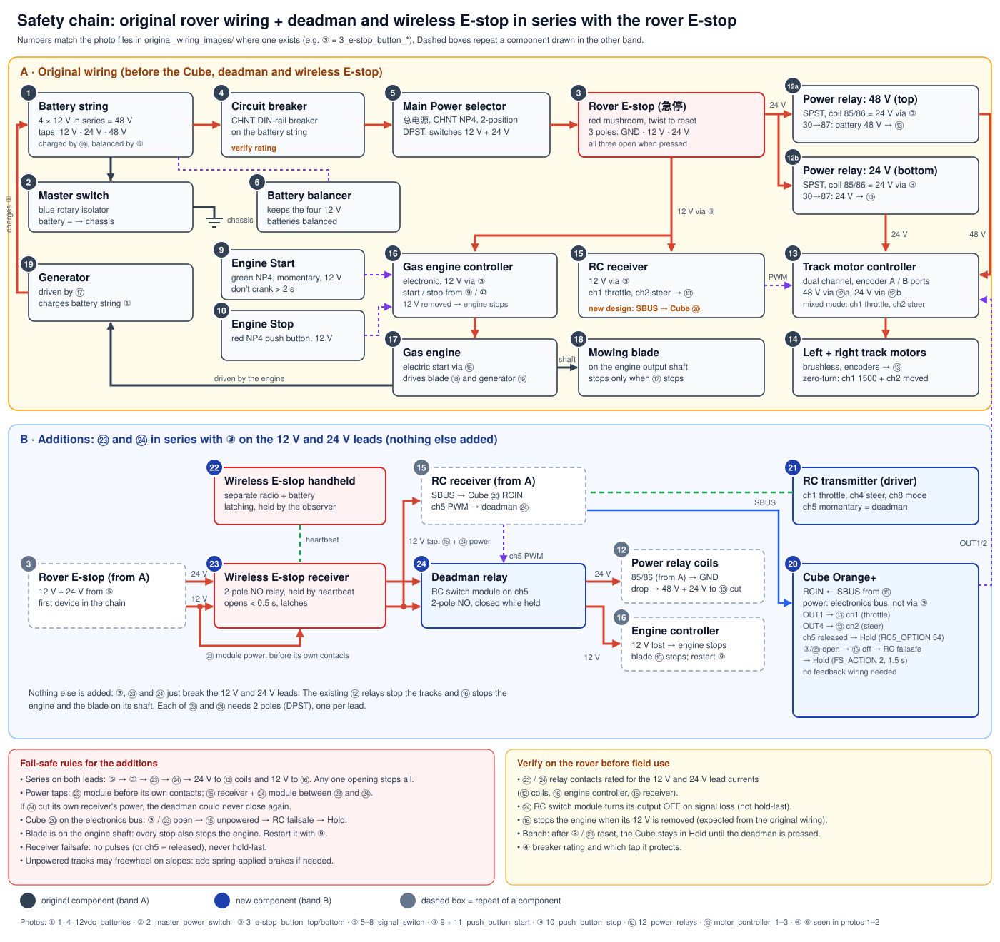
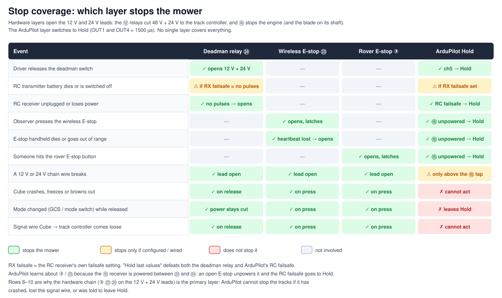

d# Deadman switch and E-stop

A mowing rover needs two separate ways to stop:

- **Deadman.** The driver holds a momentary switch to drive. Releasing it stops the mower.
- **E-stop.** Anyone can stop the mower at any time, and it stays stopped until someone resets it
  on purpose.

Both are built from a hardware safety chain that works even if the Cube fails. ArduPilot sits
behind it as a second layer.

## Why ArduPilot alone can't be the stop

The track controller runs in **mixed mode**: Cube OUT1 is throttle, OUT2 is steering, and 1500 µs is
neutral on both. In this mode **steering on its own spins the tracks**: with OUT1 at 1500 and OUT2
deflected, the mower turns on the spot. In ArduPilot Rover 4.6.2:

| Mechanism | OUT1 (throttle) | OUT2 (steering) | Stops the tracks? |
|---|---|---|---|
| Motor emergency stop (`RCx_OPTION=31`) | forced to 1500 | **still live**: `SRV_Channel::should_e_stop()` skips GroundSteering | **No** |
| Disarm / `FS_ACTION=5` (Terminate) | 1500 | **still live**: `AP_MotorsUGV::output_regular()` always outputs steering, and Auto keeps steering while disarmed | **No** |
| **Hold mode** | 1500 | **1500**: `ModeHold::update()` | **Yes**, as long as ArduPilot is running and stays in Hold |

ArduPilot also can't act if it crashes, browns out, or loses a signal wire. So the primary stop is
hardware that takes away the controllers' ENABLE.

## Layer 1: the safety chain (hardware, primary)

Three stop devices sit **in series** in the coil circuit of one safety relay, **K1**. Every device
must be closed for K1 to pull in. Any single device can stop the mower; none of them can start it on
its own.

| Device | Contact | Opens when | Resets |
|---|---|---|---|
| Rover E-stop button | NC, latching mushroom | pressed | twist to release |
| Wireless E-stop receiver | NO relay, held closed by the transmitter's heartbeat | button pressed, heartbeat lost (dead battery, out of range) | deliberate reset on the handheld or receiver |
| Deadman relay (RC switch module on receiver ch5 PWM) | NO, closed only while ch5 is held | switch released, no PWM pulses, receiver unpowered | pressing the deadman again |

K1's contacts switch the loads together:

| K1 contact | Switches | Notes |
|---|---|---|
| K1a | Track motor controller **ENABLE** input | Preferred over cutting battery power: no arcing, no regen spike into the controller |
| K1b | Blade motor controller **ENABLE** input | The blades are usually the bigger hazard and must stop with the tracks |
| K1c (optional) | Coil of a DC-rated contactor on the motor battery | Size it for the stall current. Follow the controller manual on cutting power while the motors spin. |
| K1d | Cube AUX OUT 1 + 2 to GND | Feedback to ArduPilot (Layer 2) |

### Rules that make it fail-safe

- **Energise to run.** Everything is normally open and closed only while powered. A lost coil
  supply, a blown fuse, a broken wire or a dead relay all stop the mower.
- **Feed the coil from its own fused branch**, not from a logic rail that something else can reset.
- **The RC switch module must turn its output off on signal loss.** It must not hold its last state.
  Check the datasheet, then test it.
- **Set the receiver's failsafe correctly.** Use "no pulses", or a preset failsafe with ch5 =
  released. **Never use "hold last values":** with that, a dead transmitter battery looks like a held
  deadman. Receivers take about 0.5–1 s to declare failsafe, which is 1–2 m of travel at 2 m/s.
  Re-test after every rebind or receiver firmware update.
- **Use a dedicated wireless E-stop**, not a second hobby radio. Industrial units send a continuous
  heartbeat, open within about 0.5 s when it stops, latch, and run on their own radio and battery.
  A failure in the driving radio therefore can't also disable the E-stop.
- **Plan for slopes.** With ENABLE removed, some tracked drives freewheel. If the mower can roll on
  your slopes, add spring-applied brakes that engage with power off, or use the controller's brake
  input.

## Layer 2: ArduPilot (in `config/autopilot_base.yaml`)

| Param | Value | Effect |
|---|---|---|
| `RC5_OPTION` | 54 (Hold) | Deadman released (HIGH) → Hold. Pressed (LOW) → back to the mode-switch mode. |
| `RC5_REVERSED` | 1 | Makes "released" read HIGH. Drop it if your transmitter already sends HIGH when released. |
| `RC_OPTIONS` | 160 | Bit 7 `ALLOW_SWITCH_REV` (needed for `RC5_REVERSED` to apply to a switch) + existing bit 5. Bit 2 (ignore receiver failsafe) stays off. |
| `BTN_ENABLE` | 1 | GPIO button inputs for K1 feedback |
| `BTN_PIN1` / `BTN_PIN2` | 50 / 51 | AUX OUT 1 and 2, jumpered together on the K1d contact |
| `SERVO9_FUNCTION` / `SERVO10_FUNCTION` | -1 | Makes AUX OUT 1/2 GPIO inputs. Pre-arm fails otherwise. **Reboot after upload.** |
| `BTN_FUNC1` | 54 (Hold) | Chain open → Hold, so OUT1 and OUT2 go to 1500 when power returns |
| `BTN_FUNC2` | 81 (Disarm) | Chain open → disarm, so re-arming after a reset is deliberate |
| `BTN_OPTIONS1/2` | 0 | Logic input, not inverted. K1d grounds the pins while the chain is closed; the internal pull-up reads HIGH when it is open **or the wire is broken**. |
| `FS_THR_ENABLE` / `FS_THR_VALUE` | 1 / 910 | RC failsafe on signal loss, or when ch1 is below 910 µs |
| `FS_ACTION` | 2 (Hold) | RC failsafe → Hold. **Never 5 (Terminate):** disarm leaves steering live. |
| `INITIAL_MODE` | 4 (Hold) | Boot in Hold. Only lasts until RC appears; see below. |

Behaviour in practice:

- **Boot.** The `BTN` inputs are applied at boot, so an open chain at power-on starts in Hold and
  disarmed. The RC5 Hold switch is **not** applied at boot. About 200 ms after RC appears, the mode
  switch (`MODE_CH=8`) picks the mode from `MODE1..6`, which are all Manual in the base.
- **Pressing the deadman, or resetting the chain,** returns to the mode-switch mode: Manual. A
  mission does **not** resume by itself. Restart Auto from the GCS or skynet. If you ever map a
  mode-switch position to Auto, pressing the deadman in that position resumes the mission.
- **After an E-stop reset** the Cube is in Manual and disarmed. Steering follows the stick, so keep
  it centred when you reset.

### Gaps in Layer 2 (Layer 1 covers all of them)

1. **Mode changes while released.** Moving the mode switch, or a GCS or skynet mode command, takes
   the mower out of Hold. In mixed mode it could then steer, but the deadman relay keeps ENABLE off.
2. **Steering while disarmed.** In Manual the steering stick drives OUT2 even when disarmed. With
   the chain closed, the tracks can spin.
3. **Cube or wiring failure.** If the Cube crashes, browns out or loses its signal wire to the
   controller, ArduPilot can't act.

A Lua script on the Cube could narrow gaps 1–2. It would read ch5 directly and force OUT1/OUT2 to
1500 whenever ch5 is released, regardless of mode or arming state. It isn't configured yet.

## Procedures

**Power-up:**
1. Make sure every E-stop is released or reset and the deadman is not pressed.
2. Power on. The Cube boots in Hold, and in Hold + disarmed if the chain is open.
3. Press and release the deadman once, so ch5 Hold is engaged.
4. Arm deliberately. Hold the deadman to drive.

**After an E-stop:**
1. Find out why it was pressed.
2. Centre the sticks.
3. Reset the E-stop.
4. Re-arm deliberately. The Cube is in Manual and disarmed.

## Bench test (tracks and blades off the ground, before field use)

1. **Radio calibration screen:** ch5 reads **HIGH when released** and LOW when pressed. If not, flip
   `RC5_REVERSED`.
2. **Messages tab:** opening the chain shows `Button 1: executing (Hold High)` and
   `Button 2: executing (Disarm High)`.
3. **Deadman:** arm in Manual and hold the deadman. Drive, then release mid-turn. K1 drops, both
   tracks and the blades stop, and the mode shows Hold.
4. **Auto:** start Auto from the GCS with a mission. Release during a pivot turn: everything stops.
   Pressing again returns to **Manual**, not Auto.
5. **Transmitter failure:** hold the deadman, then switch the RC transmitter off. The relay opens
   within the receiver's failsafe time. Repeat by pulling the transmitter battery.
6. **Receiver failure:** unplug the receiver's power. The relay opens.
7. **Wireless E-stop:** press it, and the mower stays stopped until reset. Turn the handheld off, or
   walk out of range: the heartbeat is lost and it stops.
8. **Rover button:** press it; the mower stops and latches.
9. **Wiring faults:** pull the K1d feedback wire, and the Cube goes to Hold + disarmed. Pull a
   chain wire, and K1 drops.
10. **Cube failure:** with the tracks running, pull the Cube's power. Releasing the deadman still
    stops the tracks.
11. **Power-cycle:** check the power-up procedure above.
